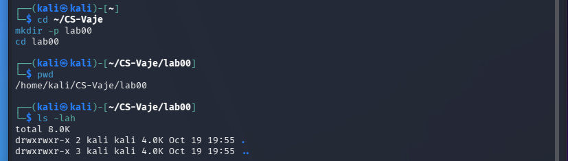
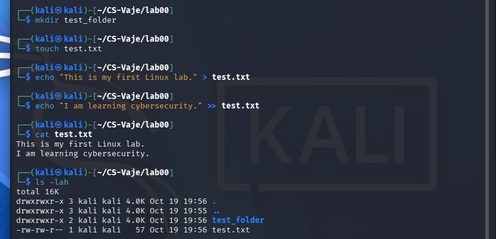
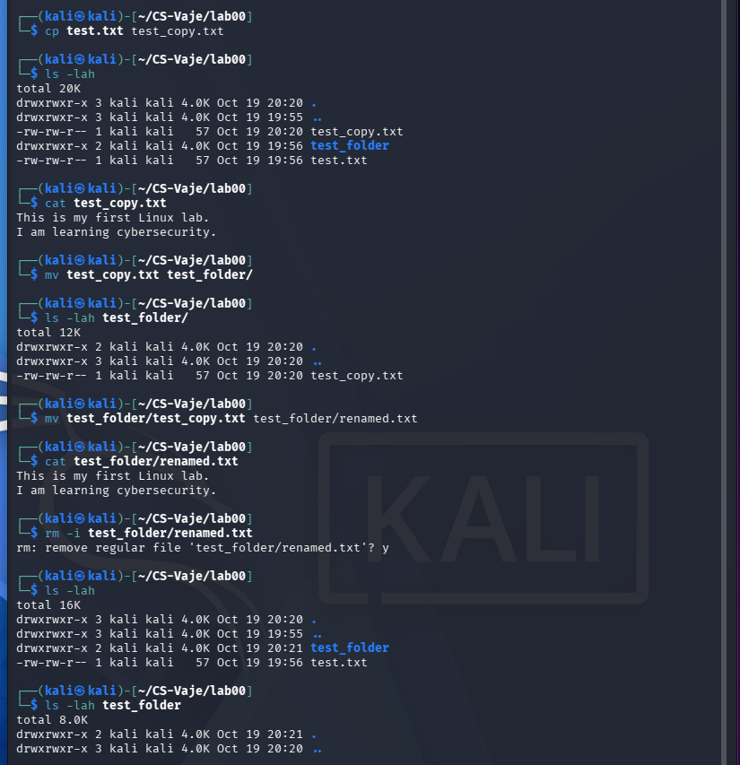
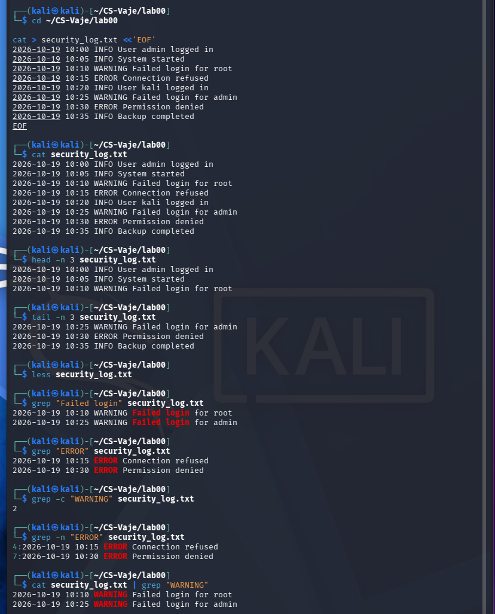
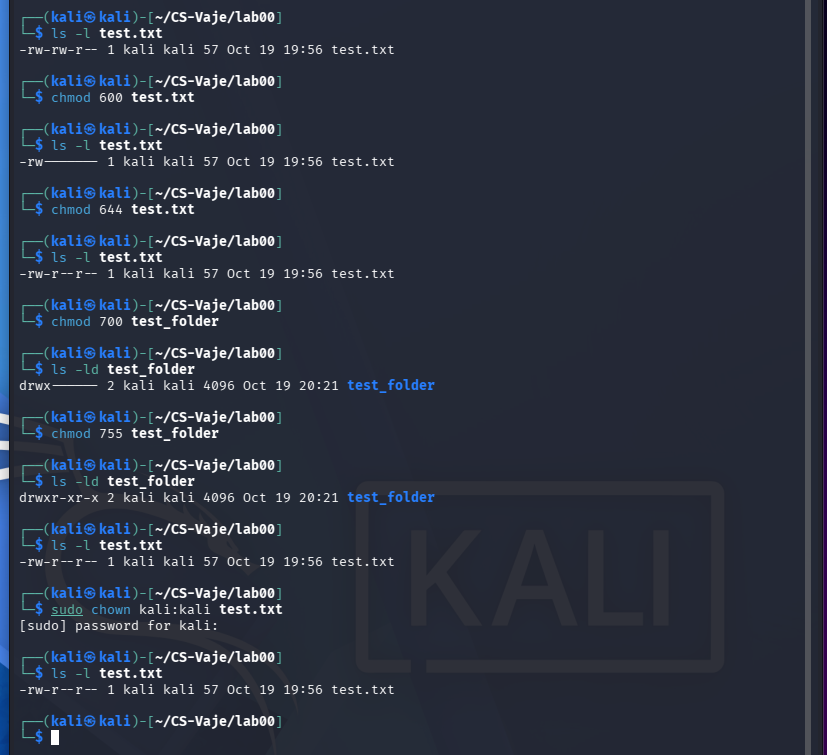
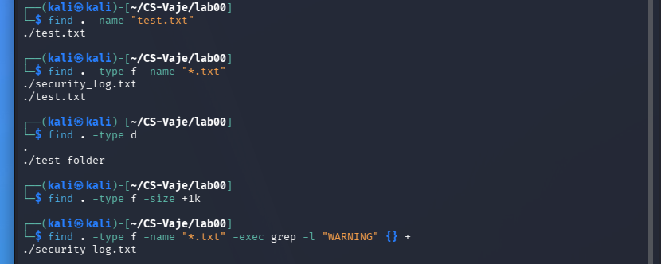

# Lab 00 — Introduction to Linux: Command Line Basics

**Student:** Nenad Damjanović  
**Environment:** Kali Linux, terminal  
**Location:** `~/CS-Vaje/lab00`  
**Date:** 19 October 2026

## Aim and context

This practical exercise introduces the Linux command-line interface, filesystem navigation, file and folder creation, file reading, copying, moving and deletion. Additional hands-on tasks demonstrate log inspection, file permissions and searching. The course handout also includes SSH connectivity as an objective; an SSH connection was **not demonstrated** in these screenshots.

## Practical work and evidence

### Directory navigation

```bash
cd ~/CS-Vaje
mkdir -p lab00
cd lab00
pwd
ls -lah
```

`pwd` printed `/home/kali/CS-Vaje/lab00`. The directory was initially empty except for `.` and `..`.



*Figure: Navigation and directory inspection.*

### File and folder creation

```bash
mkdir test_folder
touch test.txt
echo "This is my first Linux lab." > test.txt
echo "I am learning cybersecurity." >> test.txt
cat test.txt
ls -lah
```

`>` overwrites a file; `>>` appends. The file contained both lines.



*Figure: Creating files and directories.*

### File management

```bash
cp test.txt test_copy.txt
mv test_copy.txt test_folder/
mv test_folder/test_copy.txt test_folder/renamed.txt
rm -i test_folder/renamed.txt
```

The copied file retained the original text, then was renamed and deleted after explicit confirmation. `rm` normally does not move the file to a recycle bin.



*Figure: Copy, move, rename and delete.*

### Text viewing and log analysis

```bash
cat security_log.txt
head -n 3 security_log.txt
tail -n 3 security_log.txt
grep "Failed login" security_log.txt
grep -n "ERROR" security_log.txt
grep -c "WARNING" security_log.txt
```

The simulated log had two failed-login warnings and two error entries. `grep -c "WARNING"` returned `2`; `grep -n` also reported line numbers.



*Figure: Reading and searching simulated logs.*

### Permissions and ownership

```bash
chmod 600 test.txt
ls -l test.txt
chmod 644 test.txt
chmod 700 test_folder
ls -ld test_folder
chmod 755 test_folder
sudo chown kali:kali test.txt
```

Numeric permissions represent read=4, write=2 and execute=1 for owner/group/others. 600 is private file access, 644 allows public reading, 700 is private directory access and 755 permits others to traverse and read a directory.



*Figure: Linux permissions and ownership.*

### File discovery

```bash
find . -name "test.txt"
find . -type f -name "*.txt"
find . -type d
find . -type f -size +1k
find . -type f -name "*.txt" -exec grep -l "WARNING" {} +
```

The commands located test.txt, .txt files and directories. The grep-assisted search returned `./security_log.txt`.



*Figure: Finding files and text.*

## Short questions and answers

**What is the difference between CLI and GUI?** The CLI accepts typed commands and works well for automation and remote administration. A GUI uses visual controls and is convenient for interactive tasks.

**What is the difference between `>` and `>>`?** `>` creates or overwrites a file, whereas `>>` appends without discarding existing contents.

**How do `cp`, `mv` and `rm` differ?** `cp` duplicates, `mv` moves or renames, and `rm` deletes a file. `rm -i` requests confirmation.

**What do `600`, `644`, `700` and `755` mean?** These are octal owner/group/other permissions. For example, 600 grants only the owner read and write access; 755 gives full access to the owner and read/traverse access to others for directories.

**Why are `grep` and `find` important for cybersecurity?** They enable investigation of logs, discovery of relevant files, and quick filtering of possible suspicious events.

## Conclusion

All six documented practical sections were completed on Kali Linux. The screenshots show directory navigation, file creation and management, simulated log analysis, Unix permissions and filesystem searches. SSH connectivity was mentioned in the course objective but was not tested or claimed as completed in this submission.

## Source

FIŠ, *Introduction to Linux: Basics of Working in the Command Line* (cs_lab00.pdf), 2025/26.
