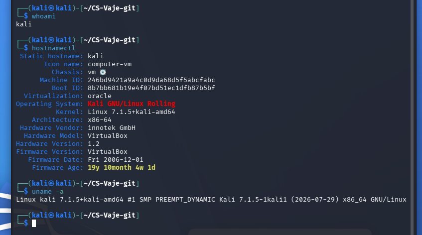
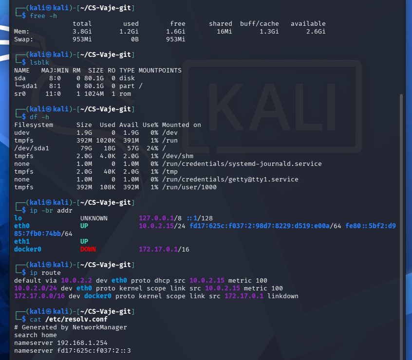
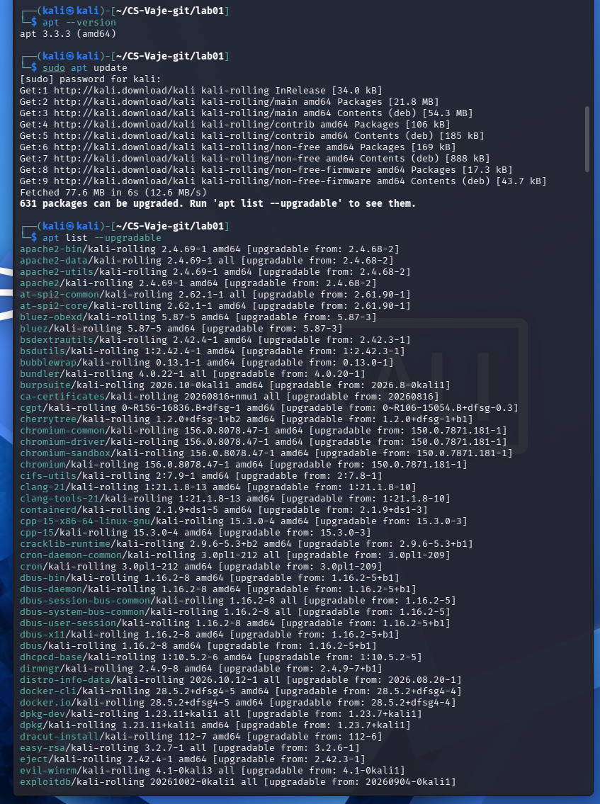
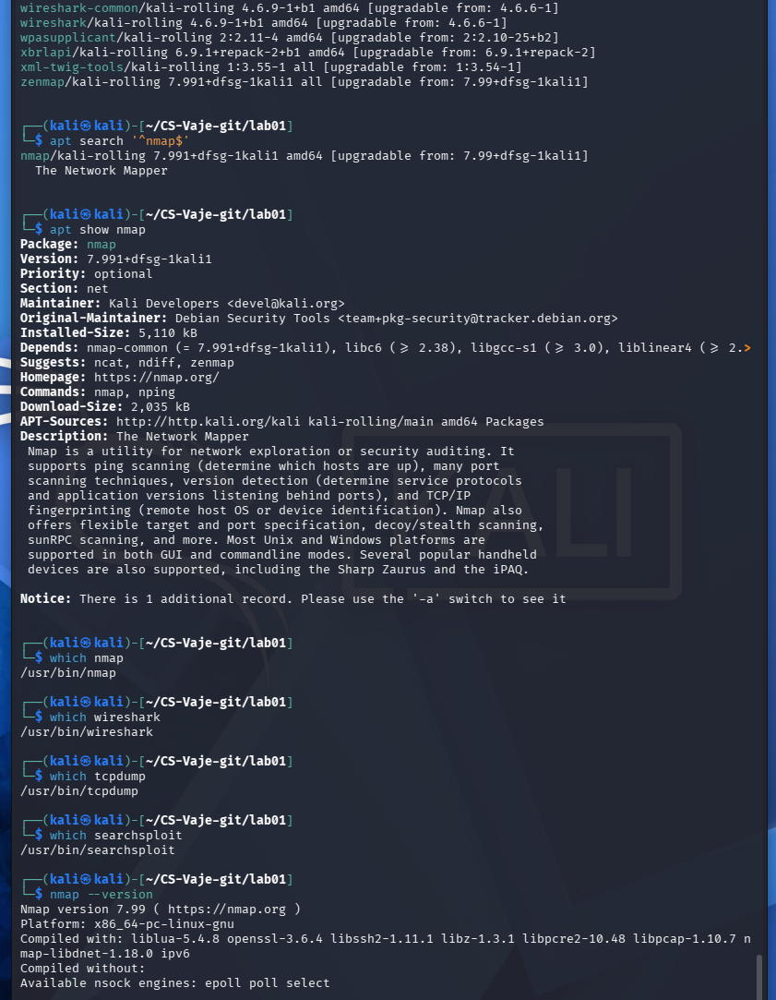
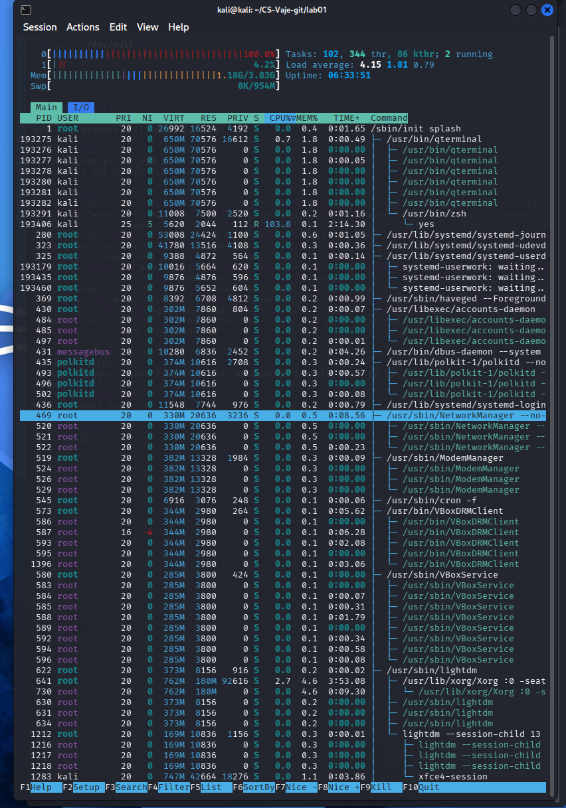
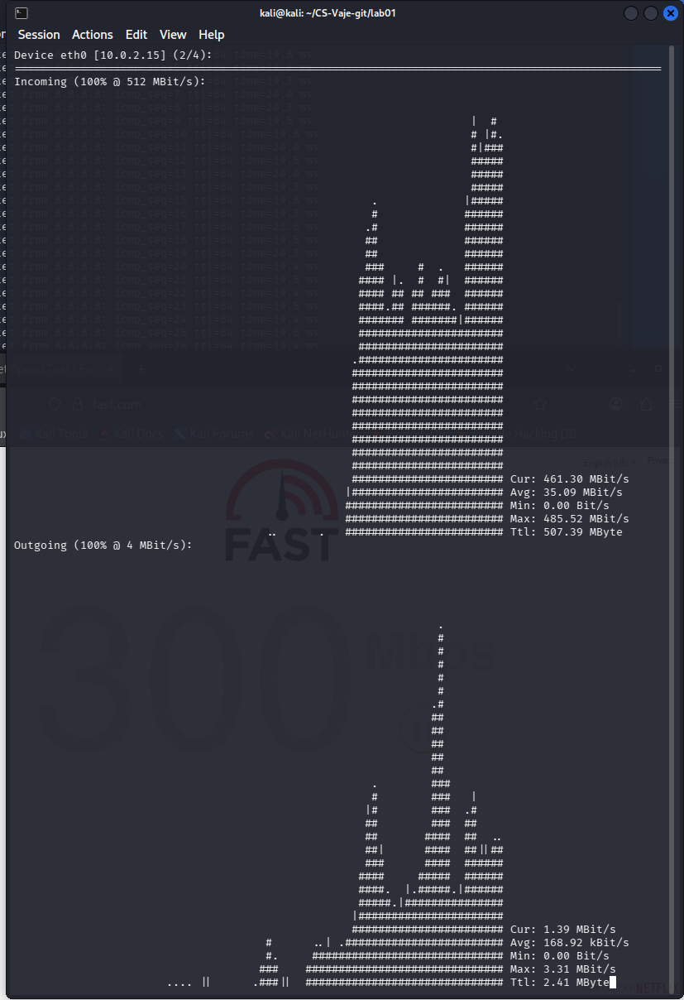
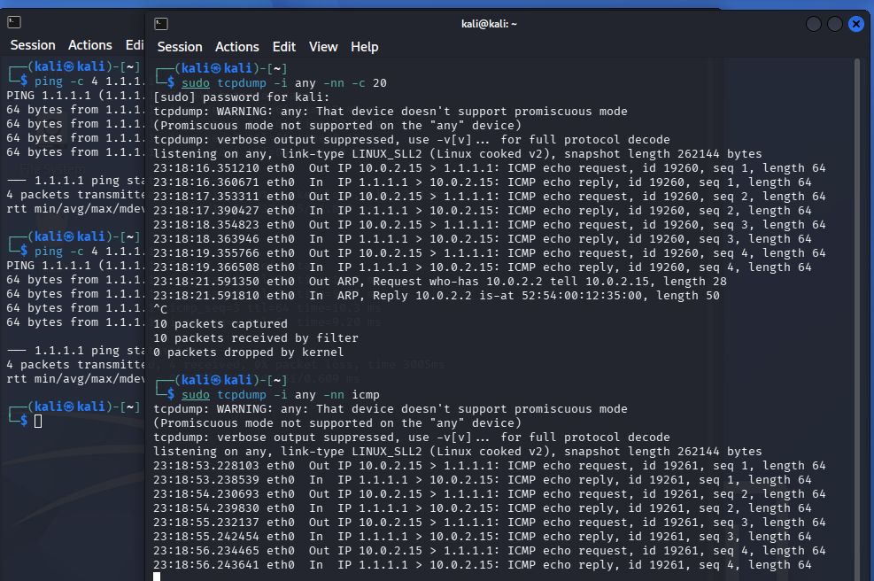
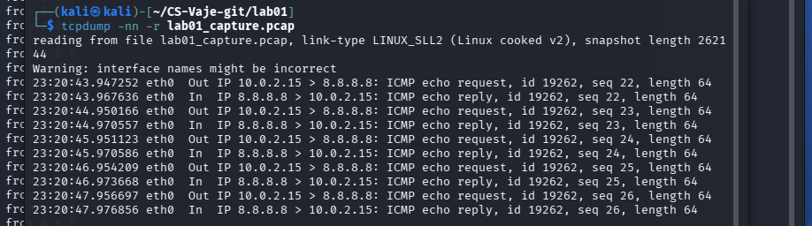
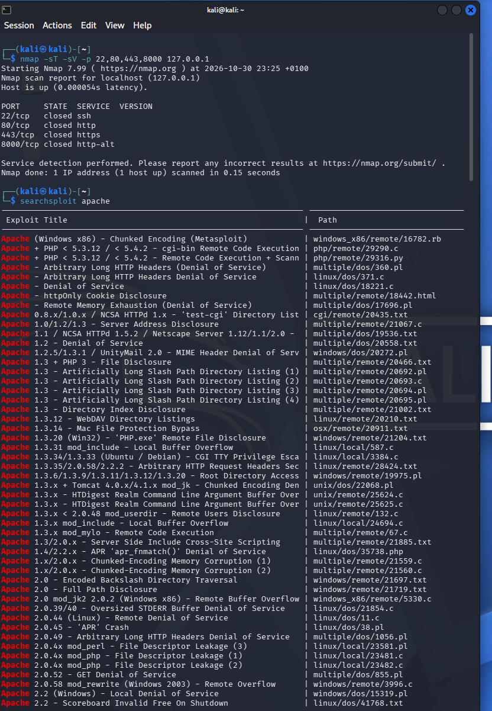
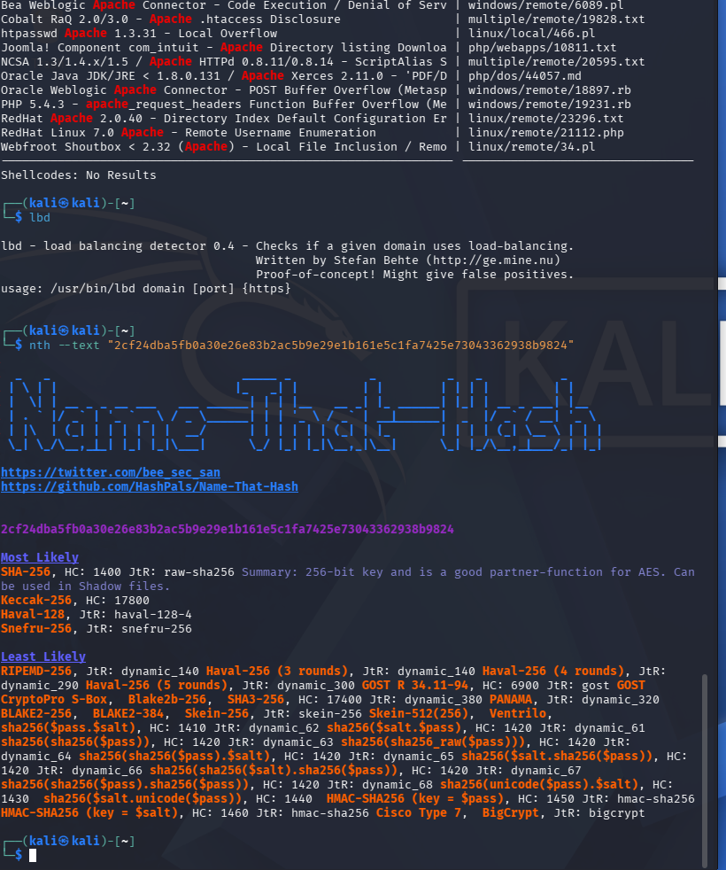

# Lab 01 — Introduction to Kali Linux

**Student:** Nenad Damjanović  
**Environment:** Kali Linux Rolling / VirtualBox  
**Course:** Cybersecurity — FIŠ

## Evidence summary

| Evidence | Description |
|---|---|
| `01-kali-environment.png` | Kali environment and system identity |
| `02-system-network-information.png` | System resources and network configuration |
| `03-apt-package-management-01.png` | APT package indexes and available updates |
| `03-apt-package-management-02.png` | Package metadata and installed tools |
| `04-process-monitoring.png` | Monitoring processes with htop |
| `05-network-diagnostics.png` | Monitoring network throughput with nload |
| `06-tcpdump-analysis-01.png` | Live tcpdump ICMP traffic |
| `06-tcpdump-analysis-02.png` | Reading captured PCAP traffic |
| `07-security-tools-overview-01.png` | Nmap localhost scan and Searchsploit |
| `07-security-tools-overview-02.png` | LBD and Name-That-Hash |

## 1. Introduction and objectives

This lab introduces Kali Linux as a security-focused Debian-derived distribution and documents practical command-line exploration, package management, process monitoring, network diagnostics, packet inspection, and security-tool discovery. The work was performed inside a VirtualBox virtual machine. The screenshots demonstrate the steps listed below; unsupported tasks are not claimed as completed.
*ChatGPT is used to create a report from my own work and screenshots

## 2. Kali Linux environment

Commands: whoami; hostnamectl; uname -a. The user was 'kali'. The VM ran Kali GNU/Linux Rolling on x86-64 under VirtualBox, with Linux kernel 7.1.5+kali-amd64. These commands establish the machine identity and kernel context before testing.

*Figure 1: Kali environment and system identity.*

## 3. Hardware and network inspection

Commands: free -h; lsblk; df -h; ip -br addr; ip route; cat /etc/resolv.conf. The VM reported approximately 3.8 GiB RAM and an 80 GiB virtual disk. eth0 was up with 10.0.2.15/24 and default gateway 10.0.2.2. DNS settings came from NetworkManager. These checks distinguish local addressing, routing and resource issues.

*Figure 2: System resources and network configuration.*

## 4. APT package management

Commands: apt --version; sudo apt update; apt list --upgradable; apt search '^nmap$'; apt show nmap; which nmap wireshark tcpdump searchsploit (run separately); nmap --version. APT 3.3.3 refreshed repositories and reported 631 upgradable packages at the time of capture. Nmap 7.99 was installed, as were Wireshark, tcpdump and Searchsploit. apt update refreshes metadata; it does not install updates.

*Figure 3: APT package indexes and available updates.*

*Figure 4: Package metadata and installed tools.*

## 5. Process monitoring

Command: htop. The screenshot shows CPU, memory, swap, process IDs, owners and per-process usage. A deliberately CPU-intensive 'yes' test process appears at approximately 103.8% CPU for one logical core. The test made the VM unresponsive, illustrating why resource tests should be bounded or avoided on small VMs; the process was terminated. High CPU consumption alone is not proof of compromise.

*Figure 5: Monitoring processes with htop.*

## 6. Network diagnostics and traffic observation

Commands introduced: ping, traceroute, nload, speedtest-cli. The supplied screenshot specifically documents nload monitoring of eth0 (10.0.2.15), including incoming/outgoing traffic during a throughput test. It does not independently document a completed traceroute or speedtest-cli result; those remain background context rather than verified screenshot findings.

*Figure 6: Monitoring network throughput with nload.*

## 7. Traffic capture with tcpdump

Commands: sudo tcpdump -i any -nn -c 20; sudo tcpdump -i any -nn icmp; tcpdump -nn -r lab01_capture.pcap. The packet screenshots show ICMP echo requests from 10.0.2.15 and replies from 1.1.1.1, as well as a saved PCAP readback involving 8.8.8.8. Capturing -i any uses a Linux cooked capture format; the promiscuous-mode warning is expected for that pseudo-interface. A PCAP contains real network metadata and should be reviewed before sharing.

*Figure 7: Live tcpdump ICMP traffic.*

*Figure 8: Reading captured PCAP traffic.*

## 8. Security tools overview

Nmap: nmap -sT -sV -p 22,80,443,8000 127.0.0.1 scanned localhost; all four listed ports were closed during the test. Searchsploit: searchsploit apache listed public exploit references, not confirmed local vulnerabilities. LBD: running lbd displayed usage help, rather than a successful target assessment. Name-That-Hash: nth --text <known SHA-256 sample> ranked SHA-256 as most likely, with other possibilities. dnsenum was discussed but no DNS enumeration execution is shown.

*Figure 9: Nmap localhost scan and Searchsploit.*

*Figure 10: LBD and Name-That-Hash.*

## 9. Reflection — faculty questions

Q1. Why use Kali Linux instead of a general-purpose distribution? Kali includes a curated environment for security assessment, forensics and network testing, saving setup time. It is not intrinsically more secure than a maintained general-purpose Linux distribution; authorization and tool configuration still matter.

Q2. Which features and tools were most interesting? Nmap for examining local service exposure, tcpdump for understanding real packet flows, htop for spotting unusual resource consumption, and Searchsploit for researching published exploit references. These tools support investigation but do not by themselves establish that a machine is compromised.

## 10. Additional concepts and limitations

The exercise instructions also mention exploring the GUI/security menu, wget, installing a sample package, strings for forensics, traceroute, speedtest-cli, Zenmap, and DNS enumeration. The screenshots supplied here do not independently evidence successful execution of all these items. The lab report therefore separates documented observations from discussed tooling. Packet collection and scans were limited to the user's test environment and loopback host.

## 11. Conclusion

The lab demonstrated core Kali workflows: inspect the system, query and manage packages, observe processes and network throughput, capture packets, and assess familiar security tools. Practical lessons include resource safety when stress testing virtual machines, correct interpretation of closed ports, and the distinction between tool output and verified security findings.

## References

- Faculty tutorial: *Introduction to Kali Linux* (course material).
- https://www.kali.org/
