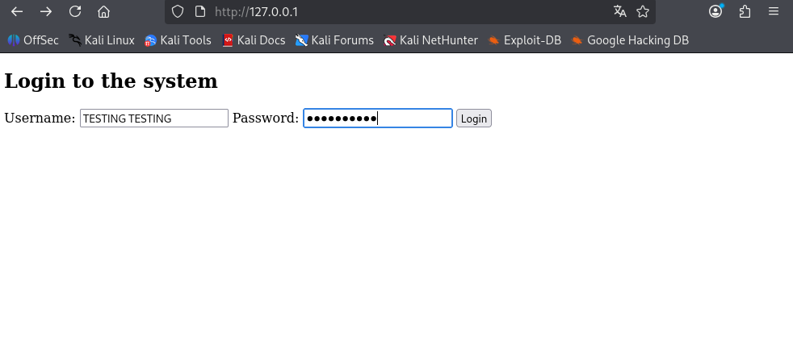
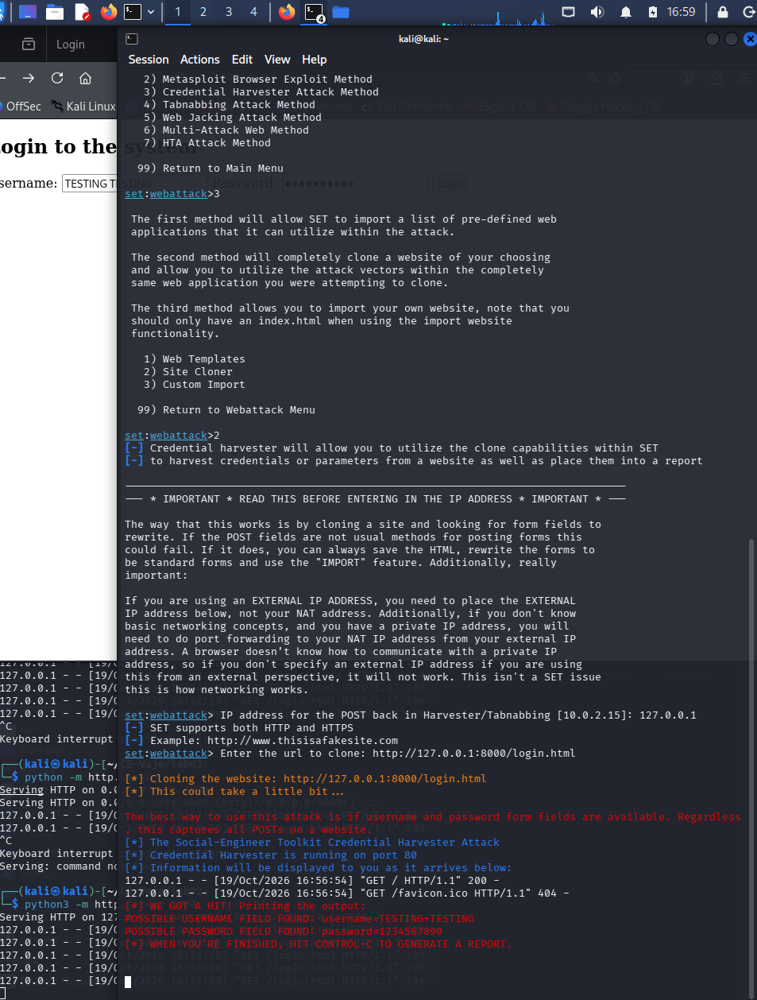

# Lab 02 — Identifying and Preventing Phishing Attacks

**Course:** Cybersecurity — Tutorials (FIŠ)  
**Exercise:** Identifying and Preventing Phishing Attacks  
**Environment:** Kali Linux (local laboratory)  
**Tools:** Social-Engineer Toolkit (SET), Python HTTP server, Firefox, curl, ss

## 1. Objective

The aim of this exercise was to recognize how phishing pages work, simulate a credential-harvesting page in an authorized local environment, observe the submitted test data, and identify ways to recognize and prevent phishing attacks.

## 2. Laboratory setup

All testing was performed locally on the Kali Linux virtual machine using the loopback IP address `127.0.0.1`. No real websites, accounts, users, or passwords were targeted.

| Component | Local address | Purpose |
|---|---|---|
| Original HTML page (Python HTTP server) | `http://127.0.0.1:8000/login.html` | Serves the test login form |
| SET Credential Harvester | `http://127.0.0.1` (port 80) | Serves the cloned form and records test POST parameters |

The test file `login.html` contained a username input, a password input, and a login button in a form using the HTTP `POST` method.

## 3. Procedure

1. Created `login.html` in `CS-Vaje/lab02` with the test login form.
2. Started a local HTTP server for the original page:

   ```bash
   python3 -m http.server 8000 --bind 127.0.0.1
   ```

3. Verified that the page was accessible using:

   ```bash
   curl -I http://127.0.0.1:8000/login.html
   ```

   The server returned `HTTP/1.0 200 OK`.

4. Opened `sudo setoolkit` and selected **Social-Engineering Attacks → Website Attack Vectors → Credential Harvester Attack Method → Site Cloner**.
5. Entered `127.0.0.1` as the local POST-back address and `http://127.0.0.1:8000/login.html` as the URL to clone.
6. Resolved a port-80 binding conflict by stopping a separate Python server that was listening on port 80, leaving the original Python server on port 8000. SET could then use port 80.
7. Opened `http://127.0.0.1` in Firefox, entered **dummy test credentials**, and submitted the form.
8. Observed the submitted values in the SET terminal.

## 4. Results and evidence

### Screenshot 1 — Cloned login page



The browser displayed the cloned login page at `http://127.0.0.1` with username and password fields.

### Screenshot 2 — Credential Harvester output



The SET terminal indicated that the Credential Harvester was running on port 80 and reported **“WE GOT A HIT!”**. It extracted the dummy form fields, including `username=TESTING+TESTING` and a test password. This demonstrated that the simulated phishing page received and logged submitted form parameters.

## 5. Analysis and reflection

**1. What are the characteristics of phishing pages?**  
A phishing page may imitate a legitimate login page while using a different or misleading URL. Warning signs include unexpected login requests, suspicious links, incorrect domains, unusual urgency, and inconsistent page details. A familiar appearance is not sufficient to establish authenticity. HTTPS alone also does not prove that a website is trustworthy.

**2. How would you protect yourself from such an attack?**  
Check the full URL and domain before entering credentials; open important services through a known bookmark or manually typed address rather than an unexpected link; use a password manager to help detect mismatched domains; use phishing-resistant authentication such as passkeys or FIDO2 security keys where available; and report suspicious login requests.

**3. Why do modern sites make such attacks more difficult?**  
Modern services may use phishing-resistant MFA, device and risk checks, account alerts, and other authentication protections. These controls can reduce the usefulness of stolen passwords, although not every MFA method provides equal resistance to phishing.

## 6. Conclusion

The local SET simulation successfully demonstrated how a cloned login form can capture submitted credentials. The experiment was limited to the student's own Kali Linux laboratory and intentionally fake data. It illustrates why users must verify the destination of login forms and why phishing-resistant authentication and user awareness are important.

## 7. Git version control and SSH authentication

The lab files were managed in a Git repository (`CS-Vaje`) on the Kali Linux virtual machine and uploaded to the student's GitHub fork. This was also an opportunity to configure secure Git authentication.

Initially, `git commit` failed because Git author information had not yet been configured. The author name and email were set with `git config --global user.name` and `git config --global user.email` (the email used for commits is separate from SSH authentication).

The first `git push origin main` attempt used the repository's HTTPS remote and failed because GitHub does not accept account passwords for Git operations over HTTPS. SSH-key authentication was configured instead:

```bash
# Create an ED25519 key pair on Kali (choose a passphrase)
ssh-keygen -t ed25519 -C "Kali-Linux-CS-Vaje"

# Display the PUBLIC key to add under GitHub > Settings > SSH and GPG keys
cat ~/.ssh/id_ed25519.pub

# Switch the repository remote from HTTPS to SSH
cd ~/CS-Vaje
git remote set-url origin git@github.com:nenaddamjanovic/CS-Vaje.git

# Test authentication, then push
ssh -T git@github.com
git push origin main
```

Only the **public** key (`id_ed25519.pub`) was added to GitHub; the private key (`id_ed25519`) remained on Kali. The SSH key was protected with a passphrase, which was requested during `git push`.

The push completed successfully, updating the remote `main` branch from `4beed1f` to **`995c282`**. This confirmed that the lab files were uploaded successfully. Future changes to this report will require another commit and push.

## 8. Files submitted

- `lab02.md` — exercise report
- `01-phishing-page.png` — browser evidence
- `02-captured-credentials.png` — SET terminal evidence
- `03-Github-SSH-connection.png` — github ssh connection terminal evidence
- `login.html` — locally created example form (include the original file from Kali if required)
