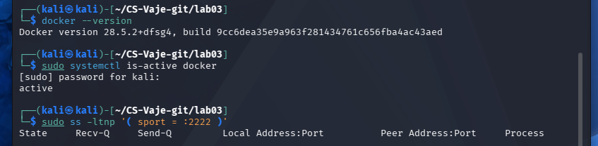
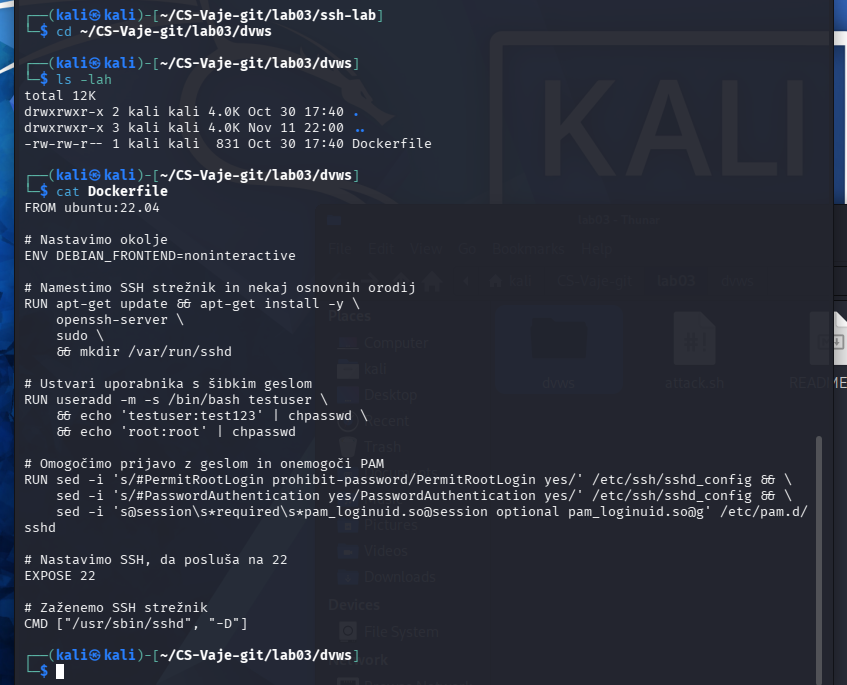
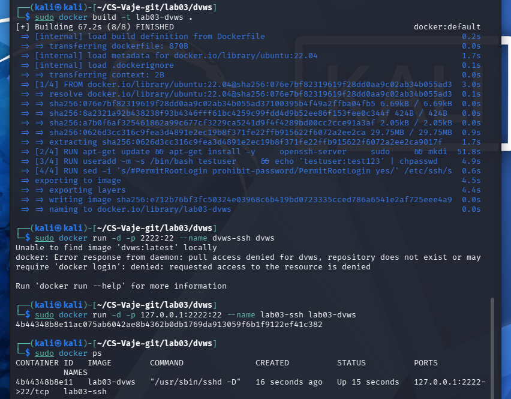
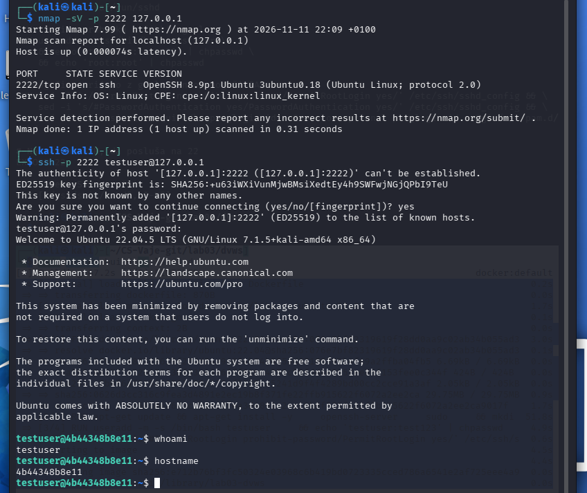
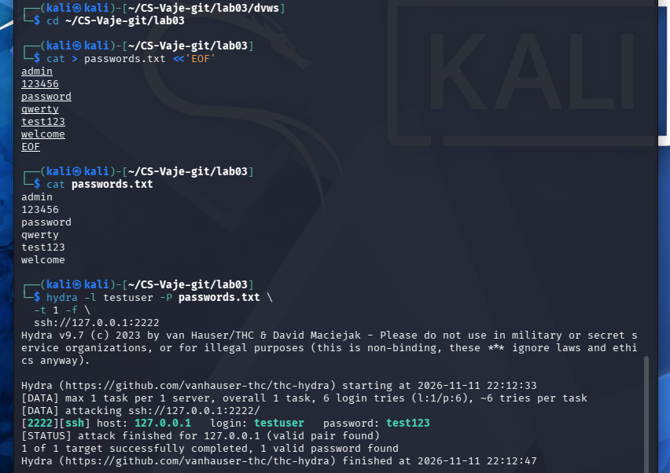
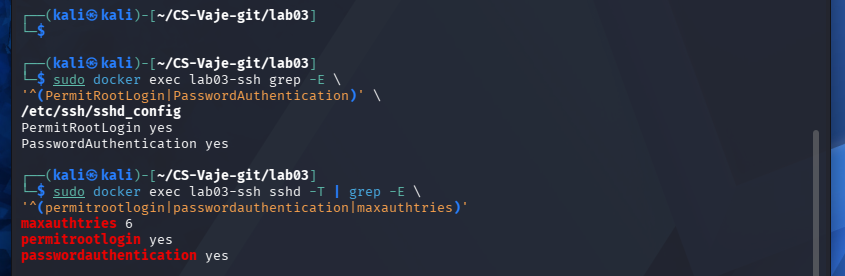
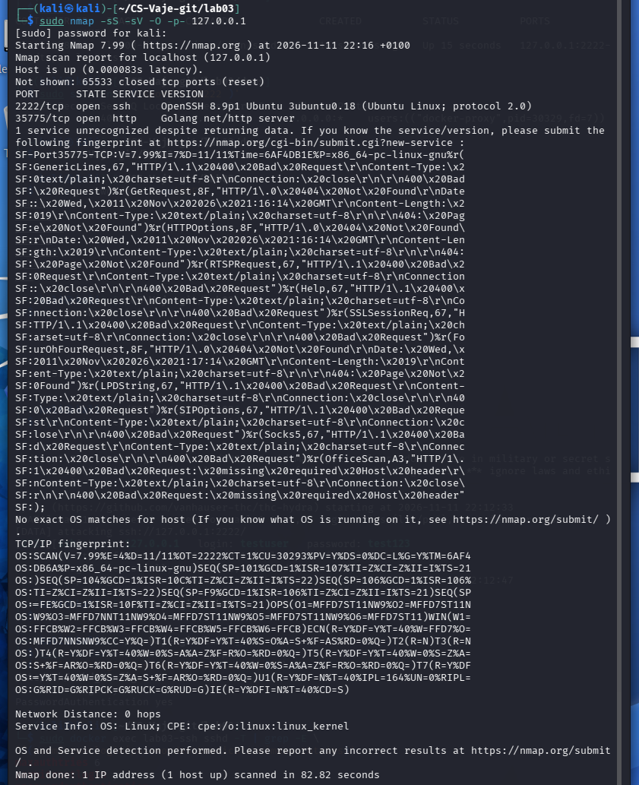

# Lab 03 — Testing SSH Security with Nmap and Hydra

**Student:** Nenad Damjanović  
**Date:** 11 November 2026  
**Environment:** Kali Linux (VirtualBox), Docker, instructor-provided Ubuntu 22.04 SSH Dockerfile  

*ChatGPT is used to create a report from my own work and screenshots*

## Objective

Perform an authorized local security assessment: create a deliberately weak SSH service, identify its open port with Nmap, verify manual login, test a short lab password list with Hydra, and explain risks and mitigations.

**Scope:** Only the locally hosted Docker SSH service on `127.0.0.1:2222` was intentionally targeted. The full localhost port scan also enumerated Kali-host ports.

## 01 — Docker prerequisites

Docker 28.5.2 was available and the Docker service was active. The local TCP port 2222 was free before starting the container.

```bash
docker --version
sudo systemctl is-active docker
sudo ss -ltnp '( sport = :2222 )'
```



## 02 — Instructor Dockerfile inspection

The instructor-provided Ubuntu 22.04 image installs OpenSSH. It deliberately defines testuser / test123 and root / root and enables password authentication and root SSH login. The Dockerfile is vulnerable by design and is suitable only for an isolated, authorized laboratory.

```bash
cd ~/CS-Vaje-git/lab03/dvws
cat Dockerfile
```



## 03 — Building and starting the SSH container

The image was built as lab03-dvws. An initial attempt to launch the different image name dvws failed; the corrected run command succeeded. The SSH port was published only on host loopback (127.0.0.1:2222), reducing exposure to other machines.

```bash
sudo docker build -t lab03-dvws .
sudo docker run -d -p 127.0.0.1:2222:22 --name lab03-ssh lab03-dvws
sudo docker ps
sudo ss -ltnp '( sport = :2222 )'
```



## 04 — Nmap service discovery and SSH validation

Nmap found TCP/2222 open and identified OpenSSH 8.9p1 Ubuntu 3ubuntu0.18. A manual SSH connection using the instructor-provided lab account succeeded. The whoami command returned testuser, proving the authentication path worked.

```bash
nmap -sV -p 2222 127.0.0.1
ssh -p 2222 testuser@127.0.0.1
whoami
hostname
exit
```



## 05 — Controlled password test with Hydra

Hydra 9.7 tested six locally defined password candidates against testuser with one task and stopped after finding test123. The recorded test ran from 22:12:33 to 22:12:47 on 11 November 2026 (14 seconds). This demonstrates that a weak password can be discovered by automated guessing in this controlled setup.

```bash
hydra -l testuser -P passwords.txt -t 1 -f ssh://127.0.0.1:2222
```



## 06 — SSH configuration analysis

The container reported PermitRootLogin yes, PasswordAuthentication yes, and MaxAuthTries 6. The two yes settings are intentionally insecure. For production: verify SSH key access first, then disable root password login and password authentication, restrict source addresses, patch OpenSSH, and monitor authentication attempts.

```bash
sudo docker exec lab03-ssh grep -E '^(PermitRootLogin|PasswordAuthentication)' /etc/ssh/sshd_config
sudo docker exec lab03-ssh sshd -T | grep -E '^(permitrootlogin|passwordauthentication|maxauthtries)'
```



## 07 — Full TCP scan and limitations

The full localhost TCP scan found port 2222 (SSH) and port 35775 (Golang net/http service). Because the target was 127.0.0.1, the second port belongs to the Kali host environment rather than necessarily to the vulnerable SSH container. Nmap did not produce an exact operating-system match. The SSH banner identifies the container service as Ubuntu OpenSSH, but that is not a reliable fingerprint of the whole host OS.

```bash
sudo nmap -sS -sV -O -p- 127.0.0.1
```



## Reflection and analysis

### 1. How would you protect SSH from brute-force attacks?

Use SSH public-key authentication, disable password authentication only after verifying successful key-based access, prohibit direct root login, deploy rate-limiting / fail2ban, and monitor failed-login events.

### 2. Which additional safeguards are recommended?

Keep OpenSSH patched; restrict inbound SSH with a firewall or management VPN; use least-privilege accounts and audited sudo; log and alert on authentication anomalies; remove unused services and close unnecessary ports. In the exercise the Docker port was bound only to loopback.

### 3. What changes if the password is strong?

The six-entry dictionary would probably fail to guess a strong, unique password. Such failure would not prove that the account is secure; broader guessing, leaked credentials, or configuration weaknesses can still matter. In this lab only the weak account was tested with Hydra.

### Why close unused ports?

Every reachable service adds attack surface. Port 35775 appeared in the scan of the Kali host; its purpose should be identified before deciding whether it is needed. It was not shown to be part of the SSH container.

## Conclusion

The intentionally weak SSH service was discoverable, manually accessible, and susceptible to automated password guessing. The exercise illustrates why password hygiene, key-based SSH authentication, restricted network exposure, and monitoring matter.

## Submission note

*ChatGPT is used to create a report from my own work and screenshots*
