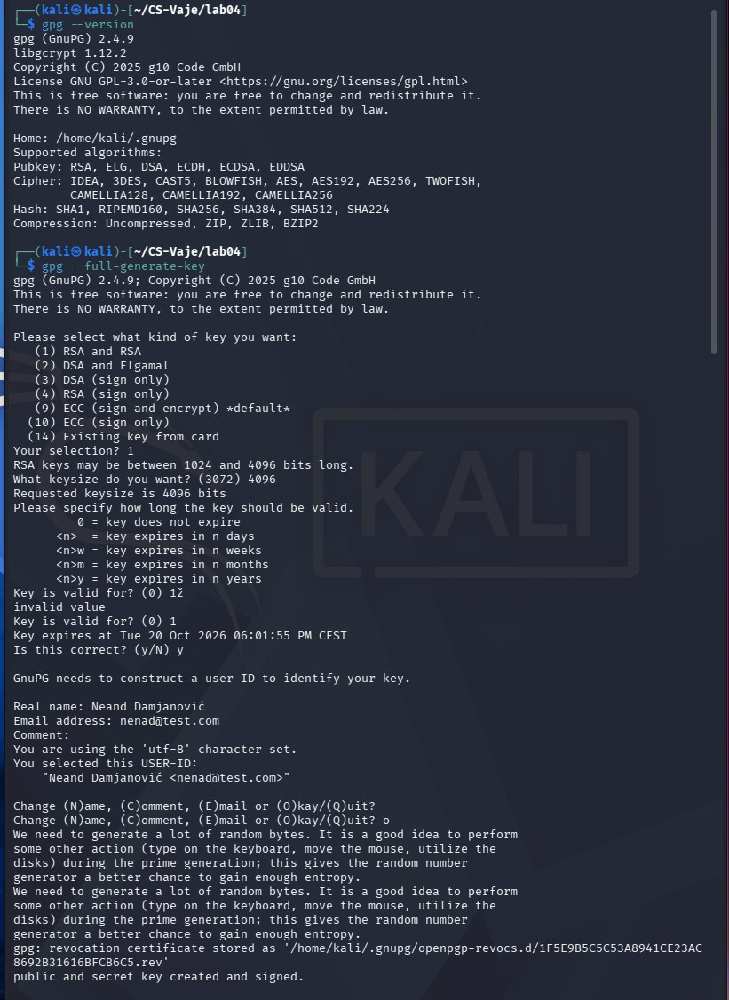
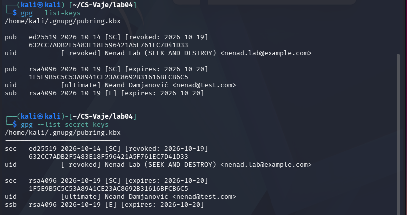
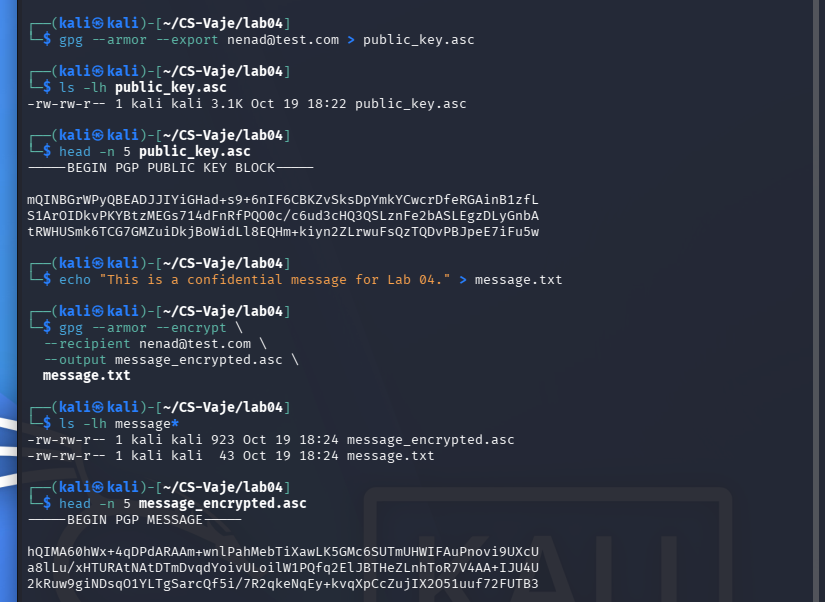
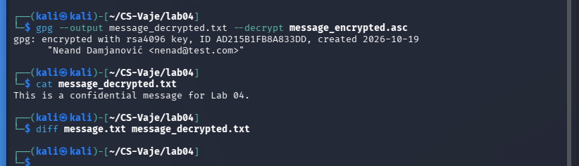
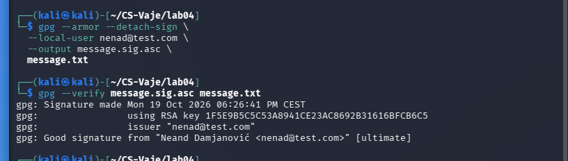
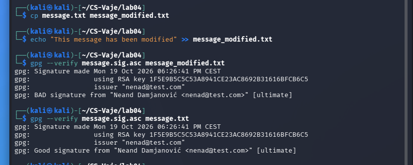
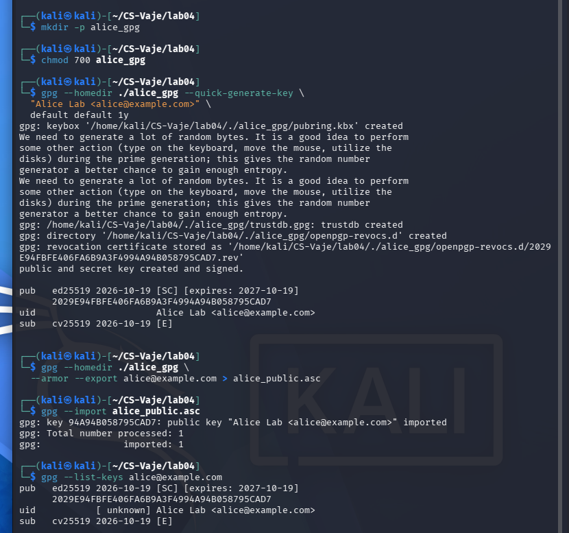
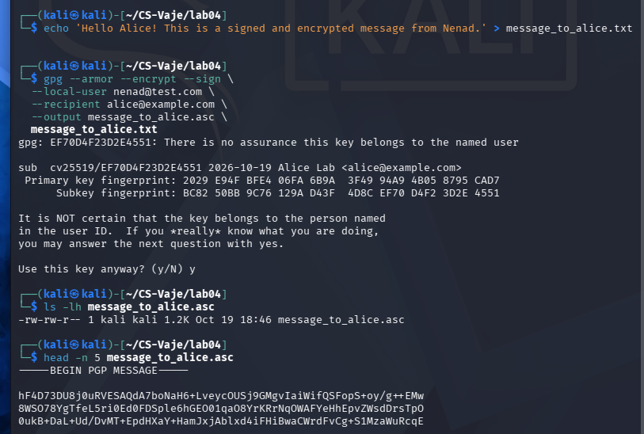
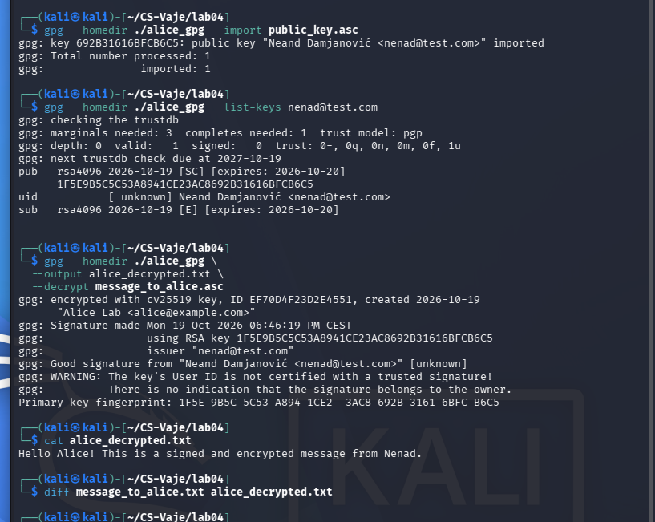

# Lab 04 — GPG: Key Generation, Encryption, and Signing

**Environment:** Kali Linux (VirtualBox)  
**Working directory:** `~/CS-Vaje/lab04`  
**Date of practical work:** 19 October 2026  
**GnuPG version:** 2.4.9  
**Exercise:** GPG: Key Generation, Encryption, and Signing

## 1. Objective

The purpose of this lab is to practice asymmetric cryptography with GNU Privacy Guard (GPG). The tasks include generating a public/private key pair, exporting and importing public keys, encrypting messages, digitally signing files, decrypting encrypted content, and verifying signatures. The exercise also demonstrates how GPG detects a changed signed message and explains the role of public-key trust.

All identities and messages used for this simulation are laboratory examples. Two independent GPG key stores were used to simulate communication between Nenad (sender) and Alice (recipient).
*ChatGPT is used to create a report from my own work and screenshots

## 2. Environment and key generation

The available version was confirmed with:

```bash
gpg --version
```

The sender's key pair was generated interactively:

```bash
gpg --full-generate-key
```

Configuration and results:

| Property | Observed value |
| --- | --- |
| Key algorithm | RSA and RSA |
| Key size | 4096 bits |
| User ID | `Neand Damjanović <nenad@test.com>` |
| Main key fingerprint | `1F5E9B5C5C53A8941CE23AC8692B31616BFCB6C5` |
| Primary key capabilities | Signing and certification (`[SC]`) |
| Subkey capability | Encryption (`[E]`) |
| Creation date | 19 October 2026 |
| Actual expiry | **20 October 2026** |

**Difference from the lab handout:** The handout specifies a one-year expiry (`1y`), but the key actually generated in this session expires after one day. The validity was **not extended or changed**. This limitation is documented rather than concealed.



Keys were inspected using:

```bash
gpg --list-keys
gpg --list-secret-keys
```

An older Ed25519 key, `632CC7ADB2F5483E18F596421A5F761EC7D41D33`, had expired. A revocation certificate was created and imported, and the key now appears as **revoked**. The certificate is not part of the GitHub submission. This is an additional local key-management exercise, separate from revoking the new RSA key.



## 3. Export the sender's public key

```bash
gpg --armor --export nenad@test.com > public_key.asc
ls -lh public_key.asc
head -n 5 public_key.asc
```

The exported file was approximately 3.1 KB and began with `-----BEGIN PGP PUBLIC KEY BLOCK-----`. ASCII armor allows a public key to be distributed as text. Only a **public** key was exported; private key material was not shared.

## 4. First encryption test: encrypting to the sender's own key

A test message was created and encrypted using the sender's public key:

```bash
echo "This is a confidential message for Lab 04." > message.txt

gpg --armor --encrypt \
  --recipient nenad@test.com \
  --output message_encrypted.asc \
  message.txt

ls -lh message*
head -n 5 message_encrypted.asc
```

The output started with `-----BEGIN PGP MESSAGE-----`, confirming a GPG ASCII-armored encrypted message was produced. This first test demonstrates encryption to the key owner's own public key, **not** communication with a second person.



The encrypted message was decrypted with the corresponding private key:

```bash
gpg --output message_decrypted.txt --decrypt message_encrypted.asc
cat message_decrypted.txt
diff message.txt message_decrypted.txt
```

**Observed plaintext:** `This is a confidential message for Lab 04.`  
The `diff` command produced no output, indicating the original and decrypted files were identical.



## 5. Digital signing and integrity demonstration

A detached ASCII-armored signature was generated with the sender's private signing key:

```bash
gpg --armor --detach-sign \
  --local-user nenad@test.com \
  --output message.sig.asc \
  message.txt

gpg --verify message.sig.asc message.txt
```

**Observed result:** `Good signature from "Neand Damjanović <nenad@test.com>" [ultimate]`.



To simulate an unauthorized change, a modified **copy** was created, keeping the original message and detached signature intact:

```bash
cp message.txt message_modified.txt
echo 'This message has been modified!' >> message_modified.txt

gpg --verify message.sig.asc message_modified.txt
gpg --verify message.sig.asc message.txt
```

The modified copy produced **`BAD signature`** while the original continued to produce **`Good signature`**. A signature does not prevent someone editing a file, but it allows recipients to detect modifications against the signed content.



**Important distinction:** This was a test of modification of a **signed plaintext file**, not a direct corruption test of the encrypted `.asc` file. Altering an encrypted GPG message would normally cause an integrity/decryption error if its protected ciphertext were changed; the precise error depends on how it is modified.

## 6. Public key import: second simulated user (Alice)

A separate GPG home directory simulated another user, so Alice's secret key was not mixed with the sender's default keyring:

```bash
mkdir -p alice_gpg
chmod 700 alice_gpg

gpg --homedir ./alice_gpg --quick-generate-key \
  "Alice Lab <alice@example.com>" \
  default default 1y

gpg --homedir ./alice_gpg \
  --armor --export alice@example.com > alice_public.asc

gpg --import alice_public.asc
gpg --list-keys alice@example.com
```

**Observed result:** One public key imported successfully. Alice's main key fingerprint was `2029E94FBFE406FA6B9A3F4994A94B058795CAD7`; it uses Ed25519 signing with a Curve25519 encryption subkey and expires 19 October 2027.

In the screenshot GPG marked Alice's key as `[unknown]` trust. This does not prevent an authorized lab test but means the key-to-identity association has not been independently verified. In real correspondence, fingerprints should be compared over a trusted separate channel before relying on a received public key.



## 7. Encrypt and sign a message addressed to Alice

A new file was created and **both** encryption and signing were requested in one GPG operation:

```bash
echo 'Hello Alice! This is a signed and encrypted message from Nenad.' > message_to_alice.txt

gpg --armor --encrypt --sign \
  --local-user nenad@test.com \
  --recipient alice@example.com \
  --output message_to_alice.asc \
  message_to_alice.txt

ls -lh message_to_alice.asc
head -n 5 message_to_alice.asc
```

GPG warned that Alice's public key identity was not certified, and its use was explicitly confirmed for this controlled lab. The output began with `-----BEGIN PGP MESSAGE-----`. The **recipient's public encryption key** protects confidentiality while the **sender's private signing key** provides a verifiable signature.



## 8. Alice decrypts and verifies the sender's signature

Alice first imported the sender's **public** key into her independent keyring:

```bash
gpg --homedir ./alice_gpg --import public_key.asc
gpg --homedir ./alice_gpg --list-keys nenad@test.com
```

Then Alice decrypted the signed encrypted message:

```bash
gpg --homedir ./alice_gpg \
  --output alice_decrypted.txt \
  --decrypt message_to_alice.asc

cat alice_decrypted.txt
diff message_to_alice.txt alice_decrypted.txt
```

**Observed results:**

- Decryption used Alice's private Curve25519 encryption key.
- GPG printed **`Good signature from "Neand Damjanović <nenad@test.com>" [unknown]`**.
- GPG also warned the sender's user ID was not certified by a trusted signature.
- The decrypted message read: `Hello Alice! This is a signed and encrypted message from Nenad.`
- `diff` returned no output, confirming both plaintext files matched.

The `Good signature` result verifies the cryptographic relationship between the message, signature, and imported public key. The `[unknown]` trust and warning mean Alice has **not independently established** that the public key belongs to the claimed person.



## 9. Answers to the questions from the exercise

### Q1. What is the difference between encryption and signing?

**Encryption** aims to keep information confidential: an authorized recipient uses the corresponding private key to decrypt a message encrypted for their public key. **Digital signing** allows the recipient to check whether the message matches the signer's cryptographic signature and whether it has been changed since signing. Signing alone does not hide the message contents.

### Q2. What is the role of the public and private key?

The **recipient's public key** is used by a sender to encrypt a message for that recipient. The **recipient's private key** is used to decrypt it. The **sender's private signing key** creates the digital signature; the **sender's public key** verifies that signature. Private keys and their passphrases must remain confidential, while public keys may be distributed but must be authenticated before they are trusted as belonging to a particular person.

### Q3. What happens when an encrypted file is modified?

When authenticated encrypted data are altered, GPG generally cannot successfully verify the message integrity and may reject decryption or report corruption, depending on the modification. The practical screenshots in this lab specifically demonstrate **a separate signed-file integrity check**: an edited plaintext copy led to `BAD signature`, whereas the untouched file still produced `Good signature`. The encrypted-file modification behavior was not tested separately in this session.

## 10. Additional learning: revocation and public-key trust

- A **revocation certificate** communicates that an existing key should no longer be relied on. An old Ed25519 key was revoked locally; generating a certificate without importing/publishing it does not automatically invalidate the key for everyone else.
- A cryptographically valid signature does **not**, by itself, prove a real-world identity. This is why GPG warned about unverified public-key ownership for Alice and Nenad in their separate keyrings.
- The course material also lists **clear-signing** (`gpg --clearsign`) as an optional additional task. It was **not performed** in the recorded session; instead, detached signatures were created and verified.

## 11. Security and GitHub submission notes

This report deliberately excludes passphrases, private keys, and revocation certificate files. In particular:

- **Do not commit `alice_gpg/`**: it contains Alice's secret keyring and related sensitive GPG files.
- **Do not commit `old_key_revoke.asc`** or other revocation certificates.
- **Do not commit `~/.gnupg/`**, private key exports, or passphrase files.
- Public-key exports such as `public_key.asc` and `alice_public.asc` are shareable, but publishing them is not necessary to establish the evidence in this report.
- **Do not use `git add .` indiscriminately** in this lab folder; stage only reviewed files.

For the documented exercise, the report and nine screenshots are sufficient evidence of the actions shown. The signing key was not renewed and still has the originally recorded one-day expiration.

## 12. Conclusion

The GPG lab demonstrated RSA 4096-bit key generation, public-key export and import, encryption, private-key decryption, detached digital signing, and successful signature verification. An altered signed file triggered `BAD signature`. A second isolated identity, Alice, imported the sender's public key, decrypted a message encrypted specifically for her, and verified the sender's signature. The results illustrate **confidentiality, message integrity, and cryptographic authentication**, while highlighting that real-world identity trust requires additional fingerprint verification.
