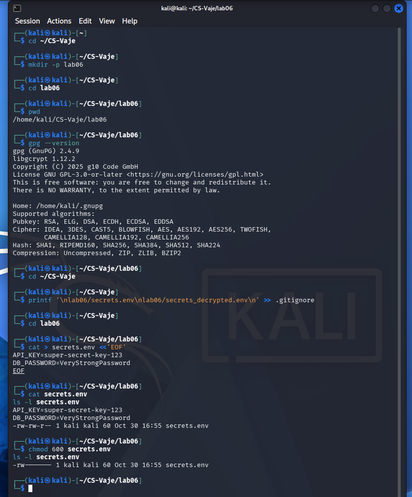
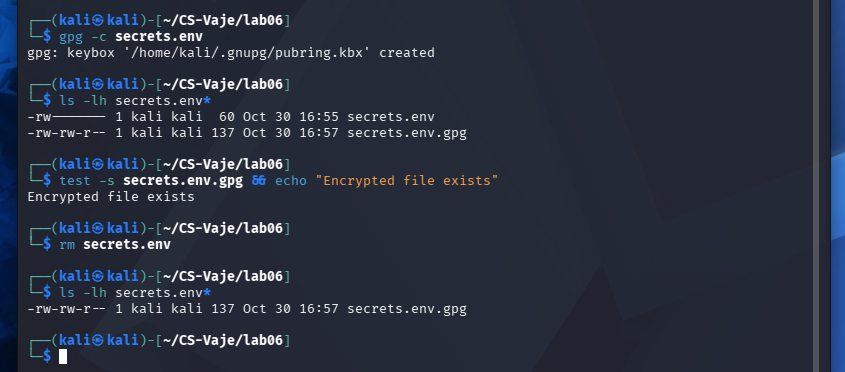
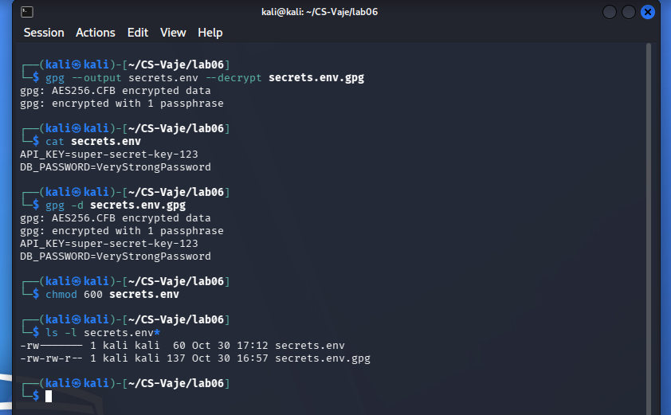
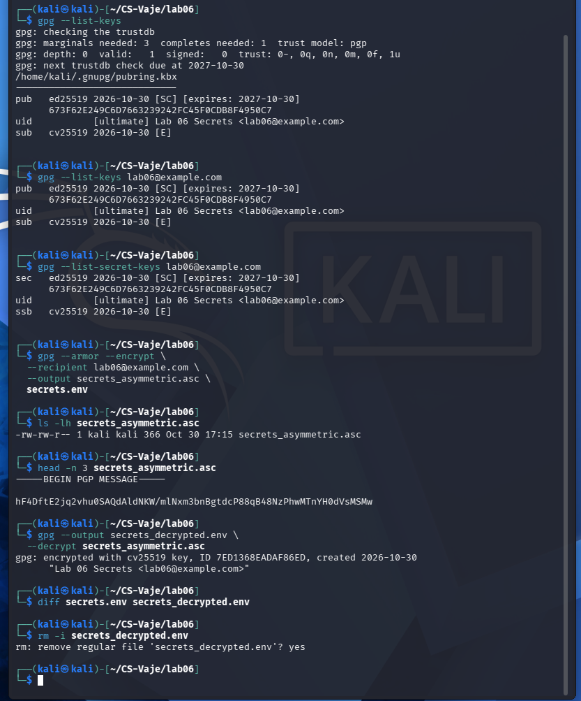
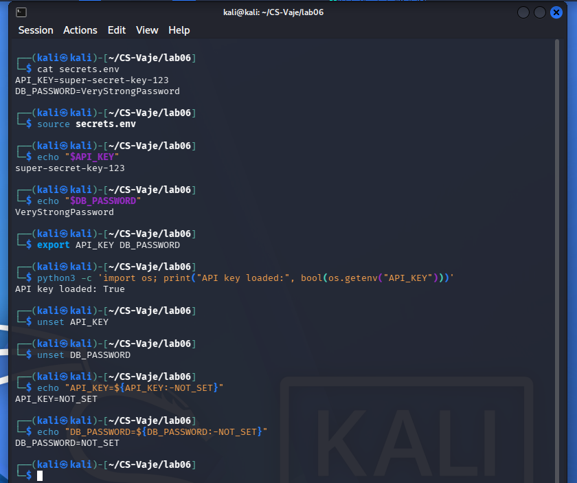
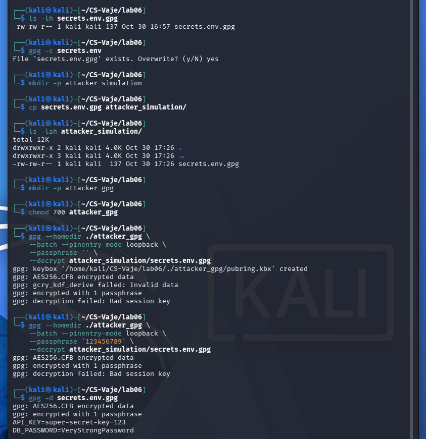

# Lab 06 — Secrets Management using GPG

**Student:** Nenad Damjanović  
**Course:** Cybersecurity — FIŠ  
**Platform:** Kali Linux (GnuPG 2.4.9)  
**Lab focus:** Protecting application secrets using GPG

## Objectives
- Keep credentials out of application source code and Git history.
- Demonstrate symmetric and asymmetric GPG encryption and decryption.
- Load and clean up environment variables in a controlled test.
- Simulate a repository leak without exposing real credentials.

> All API keys and passwords in this exercise are fictional demonstration values. Do not upload `secrets.env`, private keys, GPG home directories, or revocation certificates. *ChatGPT is used to create a report from my own work and screenshots

## 1. Lab Environment and Secret Preparation

Created ~/CS-Vaje/lab06 and verified GnuPG 2.4.9. Created a local secrets.env file with two fictional values (API_KEY and DB_PASSWORD). Changed the file permissions to 600, permitting only the owner to read and write it.

```bash
cd ~/CS-Vaje/lab06
gpg --version
cat > secrets.env <<'EOF'
API_KEY=super-secret-key-123
DB_PASSWORD=VeryStrongPassword
EOF
chmod 600 secrets.env
ls -l secrets.env
```



## 2. Symmetric Encryption

GPG encrypted the test environment file using a passphrase (the -c option). The resulting secrets.env.gpg was checked before the plaintext file was removed. This protects confidentiality at rest provided the passphrase remains strong and private.

```bash
gpg -c secrets.env
ls -lh secrets.env*
test -s secrets.env.gpg && echo "Encrypted file exists"
rm secrets.env
ls -lh secrets.env*
```



## 3. Decryption and Verification

The encrypted file was successfully decrypted using the passphrase. Both file output and terminal-output modes were demonstrated. GPG reported AES256.CFB encrypted data, and the original fictional values were recovered. The plaintext was restricted to owner access.

```bash
gpg --output secrets.env --decrypt secrets.env.gpg
cat secrets.env
gpg -d secrets.env.gpg
chmod 600 secrets.env
ls -l secrets.env*
```



## 4. Asymmetric Encryption

Generated a separate Lab 06 GPG identity (lab06@example.com) with a one-year expiration. Encrypted secrets.env to its public key. The armored output begins with BEGIN PGP MESSAGE. Decryption used the matching secret key, and diff found no differences. The temporary duplicate plaintext copy was removed.

```bash
gpg --quick-generate-key "Lab 06 Secrets <lab06@example.com>" default default 1y
gpg --list-keys lab06@example.com
gpg --armor --encrypt --recipient lab06@example.com --output secrets_asymmetric.asc secrets.env
head -n 3 secrets_asymmetric.asc
gpg --output secrets_decrypted.env --decrypt secrets_asymmetric.asc
diff secrets.env secrets_decrypted.env
rm -i secrets_decrypted.env
```



## 5. Application Integration

Used shell source to load fictional variables, export to child processes, and verified that Python could read API_KEY through os.getenv(). Then unset removed the values from the active shell session. Note: source executes shell input, so the file must be trusted.

```bash
source secrets.env
export API_KEY DB_PASSWORD
python3 -c 'import os; print("API key loaded:", bool(os.getenv("API_KEY")))'
unset API_KEY DB_PASSWORD
echo "API_KEY=${API_KEY:-NOT_SET}"
echo "DB_PASSWORD=${DB_PASSWORD:-NOT_SET}"
```



## 6. Simulated Repository Leak

Copied only the symmetrically encrypted file to a local simulated attacker directory. A separate GPG home was used. Attempts with an empty and an incorrect passphrase failed with a bad session key, whereas the authorized user could decrypt successfully. This demonstrates unsuccessful test guesses, not proof of resistance against offline password attacks.

```bash
mkdir -p attacker_simulation attacker_gpg
chmod 700 attacker_gpg
cp secrets.env.gpg attacker_simulation/
gpg --homedir ./attacker_gpg --batch --pinentry-mode loopback --passphrase '' --decrypt attacker_simulation/secrets.env.gpg
# Attempt with a wrong test passphrase also failed.
gpg -d secrets.env.gpg
```



## Questions and answers

**What is a secret, and why should it not be committed to Git?**

Secrets include passwords, API keys, tokens, and private certificates. Unencrypted secrets exposed in source history may remain accessible even after later deletion, requiring revocation and rotation.

**How does symmetric encryption differ from asymmetric encryption?**

Symmetric encryption uses one shared secret/passphrase to encrypt and decrypt. Asymmetric encryption uses the recipient public key to encrypt and a matching private key to decrypt.

**Why does chmod 600 matter if the file is encrypted later?**

File permissions restrict local access to plaintext and reduce exposure. They do not replace cryptographic protection or remove copies from backups and history.

**Why might an attacker fail to decrypt an encrypted file?**

Without the correct passphrase or private key, normal GPG decryption cannot recover the plaintext. However, a weak passphrase could be guessed offline, so encryption strength depends on secret quality and management.

**What are the advantages and limitations of environment variables?**

They decouple configuration from source code and work well with application processes, but can leak via logging, debugging, process access, or careless shell history. In production, dedicated secret managers and least privilege are preferable.

## Results and security notes

- Symmetric encryption and decryption completed successfully.
- A new Lab 06 GPG key was used for asymmetric encryption.
- Python successfully detected the exported API_KEY variable; shell cleanup returned `NOT_SET`.
- The attacker simulation failed with incorrect or absent passphrases; authorized decryption succeeded.
- The screenshots display fictional secret values only. Avoid printing real secrets.
- GPG protects encrypted data at rest; deleting plaintext with `rm` does not guarantee forensic erasure.

## Conclusion

The lab demonstrated why application secrets must not be embedded in code or committed in plaintext. GPG encryption, restrictive permissions, and responsible credential handling reduce exposure. In production, centralized tools such as HashiCorp Vault, Mozilla SOPS or AWS Secrets Manager improve secret lifecycle management.

## Reference

Robi Pritržnik, *Secrets Management using GPG*, FIŠ exercise slides, 2025/26.
