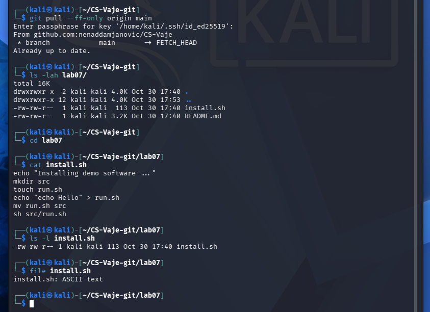
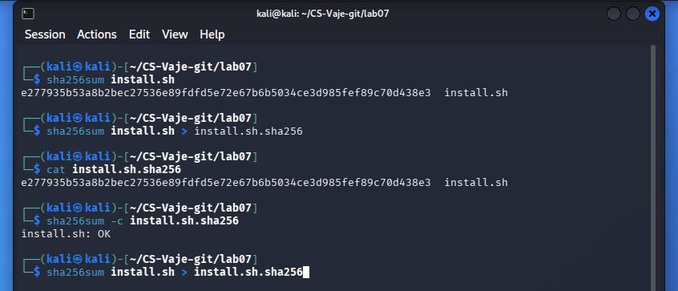
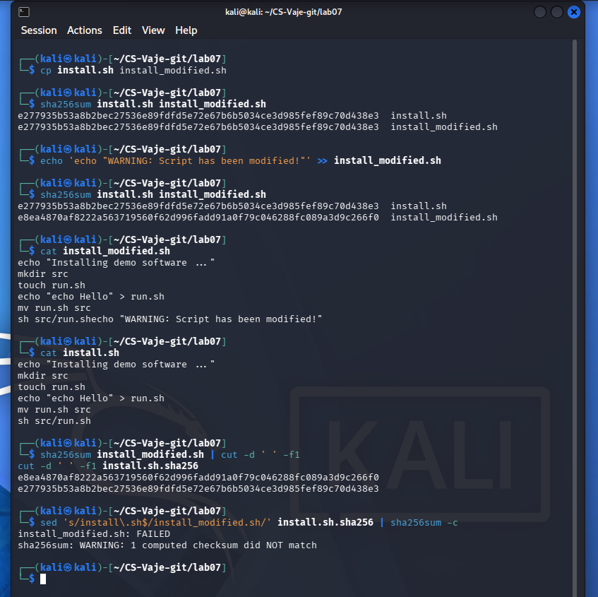
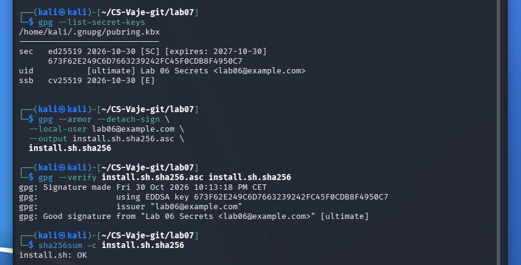
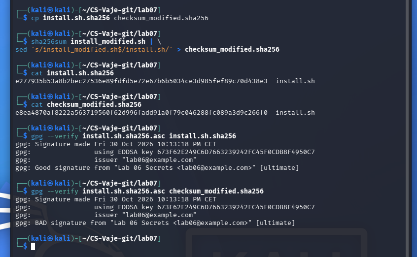
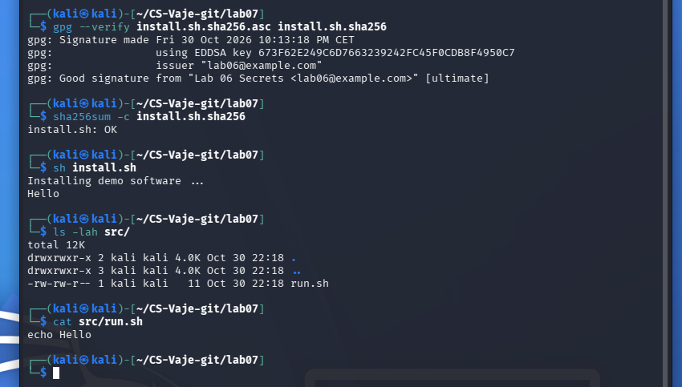

# Lab 07 — Verifying Software Integrity (SHA256 & GPG)
**Student:** Nenad Damjanović  
**Course:** Cybersecurity Laboratory  
**Environment:** Kali Linux, GnuPG 2.4.9, GNU coreutils  
**Date:** 30 October 2026

## Objective
Inspect a script, validate its SHA256 checksum, verify a GPG signature, identify tampering, and execute only after verification. All tests were performed locally with the instructor’s demo `install.sh`.
*ChatGPT is used to create a report from my own work and screenshots

## 01 — Script inspection

The provided install.sh was inspected before execution. It prints an installation message, creates src/, writes a small run.sh script, moves it into src/, and runs it to print Hello. It is a demonstration rather than a real software installer.

```bash
cat install.sh
ls -l install.sh
file install.sh
```



## 02 — SHA256 checksum

SHA256 was calculated for the original script, recorded in install.sh.sha256, and checked successfully. This confirms the file matches the recorded digest; it does not establish who created the digest.

```bash
sha256sum install.sh > install.sh.sha256
cat install.sh.sha256
sha256sum -c install.sh.sha256
# install.sh: OK
```



## 03 — Detecting script modification

A separate copy, install_modified.sh, was changed by appending a warning command. Its SHA256 digest differed from the original and the checksum verification reported FAILED. In the screenshot, the original script lacked a trailing newline, so the appended text joined the existing last line; the modified copy was not executed.

```bash
cp install.sh install_modified.sh
echo 'echo "WARNING: Script has been modified!"' >> install_modified.sh
sha256sum install.sh install_modified.sh
sed 's/install\.sh$/install_modified.sh/' install.sh.sha256 | sha256sum -c
# install_modified.sh: FAILED
```



## 04 — Signing and verifying the checksum

The already available Ed25519 secret key, Lab 06 Secrets <lab06@example.com>, was used to produce an ASCII-armored detached signature of the checksum. Signature verification reported Good signature, while SHA256 reported install.sh: OK.

```bash
gpg --armor --detach-sign --local-user lab06@example.com --output install.sh.sha256.asc install.sh.sha256
gpg --verify install.sh.sha256.asc install.sh.sha256
sha256sum -c install.sh.sha256
```



## 05 — Detecting checksum tampering

The checksum file was copied and its digest replaced with the digest of the modified script. The original detached signature still verified against the unmodified checksum, but verification against checksum_modified.sha256 returned BAD signature. This demonstrates protection of the checksum file.

```bash
gpg --verify install.sh.sha256.asc install.sh.sha256
gpg --verify install.sh.sha256.asc checksum_modified.sha256
# Good signature / BAD signature
```



## 06 — Verify before execution

The genuine checksum signature and SHA256 digest were validated before running the original demo installer without sudo. The script printed Installing demo software ... and Hello; src/run.sh contained echo Hello. A valid signature is meaningful only if the signer’s public key is independently authenticated.

```bash
gpg --verify install.sh.sha256.asc install.sh.sha256
sha256sum -c install.sh.sha256
sh install.sh
ls -lah src/
cat src/run.sh
```



## Questions and answers

**1. Why should you never execute scripts without inspection?**
Unreviewed scripts can modify the system, download other programs, steal data, or execute harmful commands. Inspecting code reduces but does not eliminate this risk.

**2. What does SHA256 guarantee?**
SHA256 produces a cryptographic digest used to detect whether content differs from an expected value. A matching independently trusted digest provides strong evidence of integrity, not authorship.

**3. What does GPG guarantee?**
A verified digital signature binds the signed data to the holder of the corresponding private key and detects post-signing changes. Authentic identity additionally depends on verifying the public key.

**4. Can SHA256 prove the author of a file?**
No. Anybody can compute a checksum, including an attacker who replaces both the script and checksum.

**5. Why is signing the checksum important?**
A detached signature prevents undetected modification of the checksum unless the attacker can also forge a valid signature from the trusted signer.

**6. What happened after the script was modified?**
The modified script had a different SHA256 digest, and verification against the original checksum failed. Separately, changing the checksum file caused GPG to report BAD signature.

## Security considerations
- Verify the signer’s public key fingerprint through an independent trusted channel; `Good signature` alone cannot prove an external developer’s identity.
- A checksum and signature validate the exact bytes tested, not whether those bytes are harmless.
- The modified script in Screenshot 03 was created as a safe local copy, and was not executed.
- No private GPG key or passphrase is included in this submission.

## Conclusion
The experiment demonstrated checksum-based integrity checks, detached-signature verification, detection of both script and checksum modification, and verification before execution.

## Source
Instructor lab instructions: *Verifying Software Integrity (SHA256 & GPG)*, CS-Vaje Lab 07.